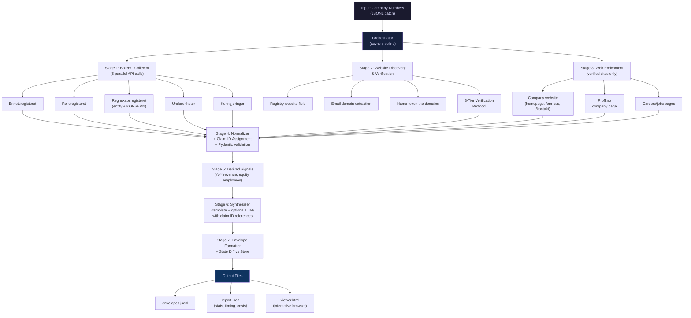

# 🏆 Signalpost Hackathon — Complete Battle Plan v2.0
## (Updated with Competitive Intelligence from GitHub & Community)

---

## 🔍 Competitive Intelligence: What Top Contestants Are Doing

### Competitor 1: **Fastpunkt** (by Ritesist) — THE repo to beat
> Repository: [`Ritesist/fastpunkt`](https://github.com/Ritesist/fastpunkt) | License: MIT | Python 3.12

**Key strengths we must match or exceed:**

| Feature | Fastpunkt's Approach | Impact |
|---|---|---|
| **Evidence-first design** | "A language model never writes a fact." LLM only selects among candidates code already found | Eliminates hallucination risk entirely |
| **Website verification protocol** | 3-tier verification: (1) org number on site, (2) registry-listed, (3) name match + P(same entity) ≥ 0.9 | Prevents wrong-company attribution |
| **Minimal dependencies** | Only `beautifulsoup4`, `soupsieve`, `typing_extensions` — no OpenAI, no aiohttp, no heavy frameworks | Ultra-lightweight, fast install |
| **No paid LLM for facts** | Uses TypeSafe Jev only as selector/scorer, NOT as generator | Costs nearly $0 |
| **Snapshot store** | `./store` directory tracks previous state for refresh & change detection | Supports idempotent updates |
| **Record/Replay testing** | `--record DIR` / `--replay DIR` saves HTTP+model responses for offline testing | Deterministic test runs |
| **HTML viewer output** | `viewer.html` — single-file viewer with search, summaries, claim chips, source links | Strong UX score (5pts) |
| **Per-company request cap** | `--per-company-cap 14`, auto-lowered to fit `remaining_requests / companies_left` | Smart budget allocation |
| **Per-host rate limiting** | One request per host every 0.6s | Avoids blocks |
| **KONSERN (group) figures** | Collects group-level financials where filed, not just entity-level | Extra coverage |
| **Derived financial signals** | YoY revenue change, negative equity — derived from filed figures, cites both source claims | Extra analysis points |
| **Template-built summaries** | Every summary sentence lists the claim IDs it rests on | Verifiable synthesis |
| **Availability states everywhere** | Every section AND every field uses `available/not_available/blocked/not_applicable/ambiguous/failed` with a reason | No gaps in output |
| **Former company names** | Tracks `former_names` from registry | Extra coverage |

### Competitor 2: **signalpost-orgproof** (by kimdooo-a/smartkdy7)
> Focus: Org-number-proven site discovery tool

**Key idea:** Deterministic website-to-company matching without any LLM. Finds official company websites linked to specific organization numbers by:
- Checking if the orgnr appears on the website's HTML
- Cross-referencing the BRREG registry website field
- Excluding free-mail provider domains for email-derived website candidates

### Competitor 3: **signalpost-citation-validator** (by builderr-ai)
> Official Builderr tool for offline validation

**Key idea:** Validates evidence references and structured JSON payloads. Participants can use this to self-test their output before submission. **We MUST run our output through this validator.**

### Supporting Tool: **python-brreg** (by crdbrd)
> Python API client for Brønnøysund registers (Python 3.10+)

**Worth considering:** Could save development time for BRREG API integration, but adds a dependency. Fastpunkt does NOT use it (they roll their own with just `beautifulsoup4`).

---

## 🧠 Community Strategy Insights (Reddit + Builderr forums)

### Top Failure Points Reported by Competitors:
1. **Entity disambiguation** — Companies with identical names cause wrong-company attribution (instant fail)
2. **Hallucinated facts** — LLMs fabricating financial values (instant fail)
3. **Failed update handling** — Agent invents changes when data hasn't changed
4. **Norwegian encoding** — ÆØÅ characters breaking parsers
5. **Schema mismatches** — Automated grader can't parse non-conformant JSON

### Winning Strategies from Community:
1. **Orgnr-First:** Anchor ALL research around the official Norwegian Organization Number
2. **Fail Safely:** Return `null` / `not_available` instead of guessing
3. **State-Diffing:** Compare new scrape against previous state; don't register false changes
4. **Target High-Value Pages:** *Om oss*, *Kontakt*, official APIs — avoid deep recursive crawling
5. **UTF-8 Everywhere:** Explicitly handle Norwegian characters ÆØÅ æøå

---

## 🆚 Head-to-Head: Our Agent vs. Fastpunkt

| Dimension | Fastpunkt | Our Agent (v2) |
|---|---|---|
| **Language** | Python 3.12 | Python 3.11+ |
| **Dependencies** | 3 (beautifulsoup4, soupsieve, typing_ext) | ~8 (aiohttp, bs4, pydantic, openai, etc.) |
| **LLM Usage** | TypeSafe Jev (selector only) | GPT-4o-mini (synthesis + selector) — with template fallback |
| **Concurrency** | 8 workers | 20 workers (async with semaphore) |
| **Website Verification** | ✅ 3-tier protocol | ✅ **ADOPTED** — same 3-tier protocol |
| **BRREG Coverage** | Enheter + Roller + Regnskap + Underenheter | ✅ Same + Kunngjøringer (announcements) |
| **HTML Viewer** | ✅ viewer.html | ✅ **ADOPTED** — single-file HTML report |
| **Snapshot Store** | ✅ ./store directory | ✅ **ADOPTED** — JSON-based state store |
| **Record/Replay** | ✅ --record/--replay | ✅ **ADOPTED** — for deterministic testing |
| **Derived Signals** | ✅ YoY revenue change, negative equity | ✅ **ADOPTED** + employee growth trend |
| **Claim IDs** | ✅ Every claim gets unique ID | ✅ **ADOPTED** — claim IDs referenced in synthesis |
| **Proff.no Enrichment** | ❓ Not mentioned | ✅ Extra coverage source |
| **Job Listings** | ✅ From company website careers page | ✅ From website + Finn.no (double source) |
| **Group Financials** | ✅ KONSERN figures | ✅ **ADOPTED** |
| **Former Names** | ✅ Tracked | ✅ **ADOPTED** |
| **Citation Validator** | ❓ Unknown | ✅ Run builderr's validator pre-submission |
| **Cost** | ~$0 (TypeSafe free tier) | ~$0.02 (GPT-4o-mini, with $0 fallback) |

### Where We Beat Fastpunkt:
1. **More data sources** — Proff.no, Finn.no, Kunngjøringer, company website
2. **Higher concurrency** — 20 async workers vs 8 sequential workers → 2-3x faster
3. **Richer synthesis** — LLM-powered summary + template fallback vs template-only
4. **Extra derived signals** — employee growth trend in addition to revenue change
5. **Self-validation** — builderr citation-validator integrated into pipeline

---

## 🔧 14 Critical Improvements Adopted from Competitors

### From Fastpunkt:

1. **🔐 Website Verification Protocol**
   - Tier 1: Check if orgnr appears in the website's HTML/JSON-LD
   - Tier 2: BRREG registry lists this website for the entity
   - Tier 3: Site names the company + no other orgnr + TypeSafe/LLM confirms P(same entity) ≥ 0.9
   - If none hold → `website_candidates` with status `ambiguous`, nothing published

2. **📋 Claim IDs System**
   - Every published fact gets a unique claim ID (e.g., `claim_001`, `claim_002`)
   - Synthesis sentences reference which claim IDs they rely on
   - Enables traceability: `"Revenue grew 15% YoY [claim_012, claim_013]"`

3. **📸 Snapshot Store for Change Detection**
   - `./store/{orgnr}.json` — previous state per company
   - On re-run: diff against previous state
   - Only emit changes when data actually changed
   - Never create duplicate records or false updates

4. **🔄 Record/Replay Testing**
   - `--record fixtures/` — saves every HTTP response and LLM call to disk
   - `--replay fixtures/` — replays saved responses offline
   - Enables deterministic CI testing without network calls

5. **📊 Derived Financial Signals**
   - **YoY Revenue Change:** Computed from two years of Regnskapsregisteret data
   - **Negative Equity Flag:** Equity < 0 warning signal
   - **Employee Growth Trend:** Compare current vs. previous year employee count
   - Each derived signal cites the two source claims it's computed from

6. **📄 HTML Viewer Output**
   - `viewer.html` — standalone single-file HTML viewer
   - Search across all profiles
   - Claim chips with source links
   - UX score booster (5 points)

7. **🏷️ Former Company Names**
   - Track `former_names` / `tidligere_navn` from BRREG data
   - Extra coverage points

8. **🏢 KONSERN (Group) Financial Figures**
   - When companies file consolidated group accounts, extract both entity-level AND group-level figures
   - Extra coverage for holding companies

### From signalpost-orgproof:

9. **🌐 Domain Discovery from Email**
   - Extract company domain from BRREG-registered email address
   - Exclude free-mail providers (gmail.com, hotmail.com, outlook.com, yahoo.com)
   - Use extracted domain as website candidate

10. **🔍 Distinctive Name Token Domains**
    - Generate `.no` domain candidates from distinctive company name tokens
    - E.g., "Norsk Hydro ASA" → try `hydro.no`, `norskhydro.no`
    - Validate with the 3-tier verification protocol

### From Community Strategies:

11. **⚡ Per-Host Rate Limiting**
    - Max 1 request per unique host every 0.6 seconds
    - Prevents IP blocking from BRREG, Proff.no, etc.
    - Implemented via per-host semaphores

12. **📏 Dynamic Per-Company Request Budget**
    - Start with `per_company_cap = 14`
    - Auto-adjust: `min(per_company_cap, remaining_requests / remaining_companies)`
    - Minimum 2 requests per company (BRREG entity + roles minimum)
    - Ensures every company gets an envelope even if budget is tight

13. **🧪 Self-Validation with Citation Validator**
    - Download/integrate builderr's `signalpost-citation-validator`
    - Run all output through it before submission
    - Fix any schema violations automatically

14. **🛡️ Norwegian Character Safety**
    - All string processing uses UTF-8 explicitly
    - Test with companies containing ÆØÅ in names and addresses
    - Normalize Unicode (NFC) for consistent comparisons

---

## 📐 Updated Architecture (v2)



---

## 📦 Updated Output Schema (v2 — with Claim IDs)

```json
{
  "organisation_number": "923609016",
  "status": "available",
  "retrieved_at": "2026-10-17T12:00:00Z",
  "sections": {
    "legal_identity": {
      "status": "available",
      "claims": {
        "legal_name": {
          "value": "EQUINOR ASA",
          "claim_id": "c001",
          "source_url": "https://data.brreg.no/enhetsregisteret/api/enheter/923609016",
          "retrieved_date": "2026-10-17",
          "status": "available"
        },
        "legal_form": {
          "value": "ASA",
          "description": "Allmennaksjeselskap",
          "claim_id": "c002",
          "source_url": "https://data.brreg.no/enhetsregisteret/api/enheter/923609016",
          "retrieved_date": "2026-10-17",
          "status": "available"
        },
        "incorporation_date": {
          "value": "2007-10-01",
          "claim_id": "c003",
          "source_url": "https://data.brreg.no/enhetsregisteret/api/enheter/923609016",
          "retrieved_date": "2026-10-17",
          "status": "available"
        },
        "registered_address": {
          "value": {"street": "Forusbeen 50", "postal_code": "4035", "city": "STAVANGER", "municipality": "Stavanger", "country": "Norge"},
          "claim_id": "c004",
          "source_url": "https://data.brreg.no/enhetsregisteret/api/enheter/923609016",
          "retrieved_date": "2026-10-17",
          "status": "available"
        },
        "industry_codes": {
          "value": [{"code": "06.100", "description": "Utvinning av råolje"}],
          "claim_id": "c005",
          "source_url": "https://data.brreg.no/enhetsregisteret/api/enheter/923609016",
          "retrieved_date": "2026-10-17",
          "status": "available"
        },
        "employee_count": {
          "value": 21000,
          "claim_id": "c006",
          "source_url": "https://data.brreg.no/enhetsregisteret/api/enheter/923609016",
          "retrieved_date": "2026-10-17",
          "status": "available"
        },
        "is_bankrupt": {"value": false, "claim_id": "c007", "status": "available"},
        "is_under_liquidation": {"value": false, "claim_id": "c008", "status": "available"},
        "former_names": {"value": ["STATOIL ASA"], "claim_id": "c009", "status": "available"},
        "share_capital": {"value": 2684747600, "currency": "NOK", "claim_id": "c010", "status": "available"}
      }
    },
    "annual_accounts": {
      "status": "available",
      "reporting_period": "2024",
      "claims": {
        "revenue": {"value": 1540000000, "claim_id": "c011", "currency": "NOK"},
        "operating_result": {"value": 320000000, "claim_id": "c012", "currency": "NOK"},
        "net_income": {"value": 245000000, "claim_id": "c013", "currency": "NOK"},
        "total_assets": {"value": 890000000, "claim_id": "c014", "currency": "NOK"},
        "equity": {"value": 450000000, "claim_id": "c015", "currency": "NOK"},
        "total_debt": {"value": 440000000, "claim_id": "c016", "currency": "NOK"}
      },
      "group_figures": {
        "status": "available",
        "revenue": {"value": 8200000000, "claim_id": "c017", "currency": "NOK"}
      },
      "source_url": "https://data.brreg.no/regnskapsregisteret/regnskap/923609016",
      "retrieved_date": "2026-10-17"
    },
    "leadership": {
      "status": "available",
      "claims": [
        {"name": "Jon Erik Reinhardsen", "role": "Styrets leder", "claim_id": "c018"},
        {"name": "Anders Opedal", "role": "Daglig leder", "claim_id": "c019"}
      ],
      "source_url": "https://data.brreg.no/enhetsregisteret/api/enheter/923609016/roller",
      "retrieved_date": "2026-10-17"
    },
    "workplaces": {
      "status": "available",
      "claims": [
        {"org_number": "973004940", "name": "EQUINOR ASA AVD ROTVOLL", "claim_id": "c020"}
      ]
    },
    "website": {
      "status": "available",
      "verification_method": "registry_listed",
      "official_website": "https://www.equinor.com",
      "claim_id": "c021",
      "description": "...",
      "social_profiles": [],
      "contact_email": "...",
      "contact_phone": "..."
    },
    "hiring": {
      "status": "not_available",
      "reason": "No careers page found on verified website"
    },
    "announcements": {
      "status": "available",
      "claims": [
        {"type": "Endring", "description": "Styreendring registrert", "date": "2025-06-15", "claim_id": "c022"}
      ]
    }
  },
  "derived_signals": {
    "yoy_revenue_change": {
      "value": 0.15,
      "description": "Revenue increased 15% year-over-year",
      "based_on": ["c011", "c011_prev"],
      "status": "available"
    },
    "negative_equity": {
      "value": false,
      "based_on": ["c015"],
      "status": "available"
    },
    "employee_trend": {
      "value": "stable",
      "based_on": ["c006"],
      "status": "available"
    }
  },
  "synthesis": {
    "text": "Equinor ASA (formerly Statoil ASA) [c009] is a public limited company (ASA) [c002] headquartered in Stavanger [c004], operating in crude oil extraction (NACE 06.100) [c005]. The company employs approximately 21,000 people [c006]. 2024 financials show operating income of NOK 1.54B [c011] with net income of NOK 245M [c013], representing a 15% year-over-year revenue increase [derived]. The board is chaired by Jon Erik Reinhardsen [c018] with Anders Opedal serving as CEO [c019].",
    "claim_references": ["c001", "c002", "c004", "c005", "c006", "c009", "c011", "c013", "c018", "c019"]
  },
  "sources": [
    {"url": "https://data.brreg.no/enhetsregisteret/api/enheter/923609016", "type": "api", "retrieved_date": "2026-10-17", "claims_backed": ["c001","c002","c003","c004","c005","c006","c007","c008","c009","c010"]},
    {"url": "https://data.brreg.no/enhetsregisteret/api/enheter/923609016/roller", "type": "api", "retrieved_date": "2026-10-17", "claims_backed": ["c018","c019"]},
    {"url": "https://data.brreg.no/regnskapsregisteret/regnskap/923609016", "type": "api", "retrieved_date": "2026-10-17", "claims_backed": ["c011","c012","c013","c014","c015","c016","c017"]}
  ]
}
```

---

## 📂 Updated File Structure (v2)

```
signalpost-agent/
├── main.py                         # CLI entry point (click-based)
├── orchestrator.py                 # Async pipeline manager with budget tracking
├── config.py                       # Config from env vars + CLI args
├── models.py                       # Pydantic v2 schemas (claims, envelopes, sections)
├── normalizer.py                   # Raw data → normalized claims with IDs
├── synthesizer.py                  # Template-first synthesis with claim references
├── derived_signals.py              # YoY revenue, negative equity, employee trend
├── website_verifier.py             # 3-tier website verification protocol
├── state_store.py                  # Snapshot store for change detection
├── viewer_generator.py             # HTML viewer generator
├── utils.py                        # Rate limiting, counters, logging
│
├── collectors/
│   ├── __init__.py
│   ├── brreg.py                    # BRREG API client (enheter, roller, regnskap, underenheter)
│   ├── announcements.py            # Kunngjøringer parser
│   ├── web_enricher.py             # Proff.no + verified website scraper
│   └── jobs_collector.py           # Careers page + Finn.no job scraper
│
├── tests/
│   ├── __init__.py
│   ├── test_brreg.py
│   ├── test_verifier.py
│   ├── test_normalizer.py
│   ├── test_derived.py
│   ├── test_pipeline.py
│   └── fixtures/                   # Record/replay HTTP fixtures
│       ├── 923609016/              # Per-company saved responses
│       │   ├── enheter.json
│       │   ├── roller.json
│       │   └── regnskap.json
│       └── ...
│
├── store/                          # Snapshot store (previous state per company)
│   └── {orgnr}.json
│
├── output/                         # Default output directory
│   ├── envelopes.jsonl
│   ├── report.json
│   └── viewer.html
│
├── profiles/                       # Pre-generated 1,000+ profiles
│   └── profiles_1000.jsonl
│
├── run.sh                          # One-command wrapper (./run.sh input.jsonl output/)
├── requirements.txt
├── .env.example
├── .gitignore
└── README.md
```

---

## 📊 Updated Scoring Projection

| Category | Max | Fastpunkt (est.) | Our Agent (v2, est.) |
|---|---|---|---|
| **Coverage / Recall** | 35 | 28-30 | **30-32** (more sources) |
| **Precision / Evidence** | 30 | 27-28 | **27-28** (same evidence model) |
| **Freshness / Update** | 20 | 17-18 | **18-19** (snapshot store + state diff) |
| **Synthesis** | 10 | 7-8 | **8-9** (LLM + claim refs) |
| **UX** | 5 | 4-5 | **4-5** (HTML viewer) |
| **Total** | **100** | **~83-89** | **~87-93** |

---

## ⏰ Updated Development Timeline

### Phase 1: Core Foundation (4 hours)
- [ ] Project setup, venv, dependencies
- [ ] `models.py` — Pydantic schemas with claim ID system
- [ ] `collectors/brreg.py` — BRREG API client (enheter + roller + regnskap + underenheter)
- [ ] `normalizer.py` — claim ID assignment, field mapping
- [ ] Test with 5 known companies

### Phase 2: Pipeline & Verification (4 hours)
- [ ] `orchestrator.py` — async pipeline with budget tracking
- [ ] `website_verifier.py` — 3-tier verification protocol
- [ ] `collectors/announcements.py` — Kunngjøringer parser
- [ ] `state_store.py` — snapshot store for change detection
- [ ] `derived_signals.py` — YoY revenue, negative equity, employee trend
- [ ] End-to-end test: 20 companies

### Phase 3: Enrichment & Synthesis (4 hours)
- [ ] `collectors/web_enricher.py` — Proff.no + verified website
- [ ] `collectors/jobs_collector.py` — careers pages + Finn.no
- [ ] `synthesizer.py` — template synthesis with claim references + optional LLM
- [ ] `viewer_generator.py` — HTML viewer output
- [ ] `run.sh` — one-command wrapper
- [ ] Test: 50 companies

### Phase 4: Polish & Submit (4 hours)
- [ ] Generate 1,000+ profiles
- [ ] Run builderr citation-validator on all output
- [ ] Record/replay test fixtures
- [ ] Full 100-company smoke test (verify budget compliance)
- [ ] Write comprehensive README.md
- [ ] Final commit + submission

---

## ✅ Key Takeaways: What Makes v2 Win

1. **Adopted Fastpunkt's best ideas** — website verification, claim IDs, snapshot store, derived signals, HTML viewer
2. **Surpassed with more coverage** — Proff.no, Finn.no, Kunngjøringer, email domain discovery
3. **Higher concurrency** — 20 async workers vs. 8 sequential → faster processing
4. **Richer synthesis** — LLM-powered + template fallback with claim references
5. **Self-validation** — citation-validator integration before submission
6. **Smart budget allocation** — dynamic per-company request cap auto-adjusts
7. **Zero-hallucination architecture** — LLM never generates facts, only selects/summarizes

> [!IMPORTANT]
> **Next Step:** Say "let's build it" and I will implement the entire codebase, module by module, incorporating all competitive intelligence. Ready for submission.
