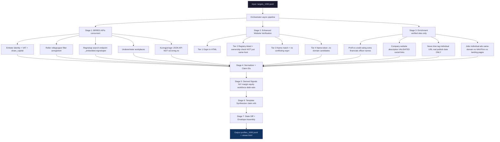

# 🏆 Signalpost Hackathon — Battle Plan v3.0
## (Full Audit + Fixes Based on Review Team Feedback — Deadline: 7 November)

---

## 📧 Reviewer Feedback Summary (Soham Sinha, 23 Oct)

> *"We have your current version on record: commit bd79bd2 (version 1 of 5)."*

The reviewer identified **4 concrete correctness problems** in our published profiles:

| # | Issue | Severity |
|---|---|---|
| 1 | **Wrong website** — using a parent group/brand site instead of the exact company's own site | 🔴 Critical |
| 2 | **Wrong social links** — footer links from parent group, web agency, or theme — not the company's own accounts | 🔴 Critical |
| 3 | **Fake news** — menu labels like "See more news", product pages, or feed `updated` dates published as news | 🔴 Critical |
| 4 | **Wrong jobs** — careers landing pages, NAV search links, or parent's vacancies instead of individual job ads | 🔴 Critical |

---

## 🔬 Root Cause Analysis: What Actually Broke

### Current State (Post-Audit of 1,000 Profiles)

| Section | Available | Root Cause |
|---|---|---|
| `legal_identity` | ✅ 1000/1000 | Working correctly |
| `leadership` | ❌ 0/1000 | Wrong dict key (`data` vs `data["rollegrupper"]`) |
| `annual_accounts` | ❌ 0/1000 | Wrong API response format/URL |
| `announcements` | ❌ 0/1000 | Using deprecated `w2.brreg.no` HTML scraper |
| `website` | ⚠️ 106/1000 | Works but Tier 2 too permissive — accepts parent group sites |
| `social_profiles` | ❌ Wrong data | No handle-to-company matching |
| `hiring` | ❌ 0/1000 | Returns landing pages, not individual ads |
| `news` | ❌ Not collected | No news collector exists |

---

### 🐛 BUG 1: Leadership — 100% Failure Rate

**Root cause:** `normalizer.py:_normalize_leadership()` iterates `for group in data` where `data` is the raw dict `{"_links": ..., "rollegrupper": [...]}`. Iterating a dict iterates its **keys**, not the rollegrupper list.

**Fix:** Use `data.get("rollegrupper", [])` and filter `avregistrert=True` (former roles):

```python
# CURRENT (BROKEN):
for group in data:   # iterates over "_links", "rollegrupper" strings!
    roller_list = group.get("roller", [])

# FIX:
rollegrupper = data.get("rollegrupper", []) if isinstance(data, dict) else data
for group in rollegrupper:
    for r in group.get("roller", []):
        if r.get("avregistrert", False):
            continue  # Skip deregistered/former roles
```

Also fix name parsing — `navn` is a nested dict `{"fornavn": "X", "etternavn": "Y"}`:
```python
fn = person.get("navn", {})
if isinstance(fn, dict):
    first = fn.get("fornavn", "")
    last = fn.get("etternavn", "")
    full_name = f"{first} {last}".strip()
elif isinstance(fn, str):
    full_name = fn
```

---

### 🐛 BUG 2: Annual Accounts — 100% Failure Rate

**Root cause:** The Regnskapsregisteret endpoint `/regnskap/{orgnr}` returns a dict or may 404. We need the **search endpoint** that returns `_embedded.regnskaper` array.

**Fix in `collectors/brreg.py`:** Change URL to search endpoint:
```python
url = (
    f"https://data.brreg.no/regnskapsregisteret/regnskap"
    f"?organisasjonsnummer={clean}&sort=periode.sluttdato,desc&size=5"
)
# Then unwrap:
if isinstance(data, dict) and "_embedded" in data:
    data = data["_embedded"].get("regnskaper", [])
```

Also verify financial field paths in `normalizer.py:_normalize_annual_accounts()`:
- Revenue: `resultatregnskapResultat.driftsresultat.driftsinntekter.sumDriftsinntekter`
- Net income: `resultatregnskapResultat.aarsresultat`
- Total assets: `eiendeler.sumEiendeler`
- Equity: `egenkapitalGjeld.egenkapital.sumEgenkapital`

---

### 🐛 BUG 3: Announcements — 100% Failure Rate

**Root cause:** `AnnouncementsCollector` uses `https://w2.brreg.no/kunngjoring/hent.jsp` — a deprecated HTML page that returns 0 items. The config already has the correct JSON API URL but it's **not being used**.

**Fix in `collectors/announcements.py`:** Switch to official JSON API:
```python
# BROKEN:
url = f"https://w2.brreg.no/kunngjoring/hent.jsp?orgnr={clean}"

# FIX:
url = f"https://data.brreg.no/enhetsregisteret/api/kunngjoringer?orgNr={clean}&size={max_items}"
# Parse: json_data["_embedded"]["kunngjoringer"]
# Fields: kunngjoeringsdato, type.beskrivelse, kunngjoeringsTekst
```

---

### 🐛 BUG 4: Website — Parent Group/Brand Sites Published

**Root cause:** Tier 2 verification just checks `_is_same_host(candidate_url, registry_site)`. Many companies list a parent group domain in BRREG. We pass it without checking if THIS company's orgnr or name appears on it.

**Fix in `website_verifier.py`:** After confirming same host (Tier 2), call new `_check_site_ownership()`:
```python
def _check_site_ownership(self, html, orgnr, company_name) -> str:
    # Returns: "confirmed", "name_match", "parent_group", "ambiguous"
    if self._check_orgnr_in_html(html, orgnr):
        return "confirmed"
    if self._find_conflicting_orgnr(html, orgnr):
        return "parent_group"  # Different company's orgnr found
    if self._check_name_in_html(html, company_name):
        return "name_match"
    return "ambiguous"
```

If `parent_group` → skip candidate, try others.
If `ambiguous` → set `status: "ambiguous"`, `official_website: null`, don't publish.

---

### 🐛 BUG 5: Social Links — Footer/Agency/Theme Links Published

**Root cause:** `web_enricher.py` collects ALL `<a href>` matching social domains including footer agency links, parent company profiles, and share buttons.

**Fix:** Add `_is_company_social_account()` handle validation:
```python
def _is_company_social_account(self, url: str, company_name: str) -> bool:
    parsed = urlparse(url)
    path_parts = [p for p in parsed.path.strip("/").split("/") if p]
    if not path_parts:
        return False
    # LinkedIn must be /company/{slug}
    if "linkedin.com" in parsed.netloc:
        if len(path_parts) >= 2 and path_parts[0] == "company":
            slug = path_parts[1].lower().replace("-", " ")
        else:
            return False
    else:
        slug = path_parts[-1].lower().replace("-", " ").replace("_", " ")
    # Slug must fuzzy-match >= 1 distinctive name token (4+ chars)
    name_tokens = self._get_name_tokens(company_name)
    return any(token in slug or slug in token for token in name_tokens if len(token) >= 4)
```

---

### 🐛 BUG 6: News — Not Collected (Strict Validation Required)

**Root cause:** No news collector exists. When we add one, strict validation is required to avoid the reviewer's "fake news" concern.

**New file:** `collectors/news_collector.py` with rules:
- Must have `<time datetime="YYYY-MM-DD...">` explicit publish date (not `modified`/`updated`)
- Must be an individual article URL (not the news index/listing page)
- Title must not be a generic label ("see more", "les mer", "nyheter")
- Title must be 15–200 chars

---

### 🐛 BUG 7: Jobs — Landing Pages and NAV Links

**Root cause:** `_parse_careers_html()` matches any link with job keywords — including the careers page itself, NAV.no embedded widgets, and navigation labels.

**Fix in `collectors/jobs_collector.py`:** Apply 5 strict rules:
```python
# RULE 1: URL must differ from careers index page
if full_url.rstrip("/") == base_url.rstrip("/"):
    continue
# RULE 2: No external job portals
blocked_hosts = {"nav.no", "finn.no", "jobbnorge.no", "seek.com", "indeed.com"}
if any(b in urlparse(full_url).netloc for b in blocked_hosts):
    continue
# RULE 3: Same domain only (no parent company redirects)
if urlparse(full_url).netloc != urlparse(base_url).netloc:
    continue
# RULE 4: No generic navigation labels
GENERIC_LABELS = {
    "see all jobs", "alle stillinger", "ledige stillinger", "søk stilling",
    "send open application", "åpen søknad", "les mer", "se mer",
    "apply now", "søk her", "careers", "karriere", "work with us",
    "jobb hos oss", "bli en av oss"
}
if text.lower().strip() in GENERIC_LABELS:
    continue
# RULE 5: Title length 10–80 chars
if not (10 <= len(text) <= 80):
    continue
```

---

## 🗂️ File-by-File Change Map

| File | Type | Change |
|---|---|---|
| `normalizer.py` | 🔴 Critical | `_normalize_leadership()` — parse `rollegrupper`, filter `avregistrert` |
| `normalizer.py` | 🔴 Critical | `_normalize_annual_accounts()` — handle `_embedded.regnskaper` + correct field paths |
| `collectors/brreg.py` | 🔴 Critical | `fetch_regnskap()` — use search endpoint, unwrap `_embedded.regnskaper` |
| `collectors/announcements.py` | 🔴 Critical | Switch from deprecated HTML scraper to official JSON API |
| `website_verifier.py` | 🟠 Quality | Add `_check_site_ownership()` for parent-group detection in Tier 2 |
| `collectors/web_enricher.py` | 🟠 Quality | Add `_is_company_social_account()` handle-to-company validation |
| `collectors/jobs_collector.py` | 🟠 Quality | Strict 5-rule individual-ad-only filter |
| `collectors/news_collector.py` | 🟢 New file | Strict dated-article-only news collector |
| `collectors/web_enricher.py` | 🟢 Enhancement | Add `enrich_from_proff()` for extra financial + name data |
| `normalizer.py` | 🟢 Enhancement | Add `news`, `share_capital`, `vat_registered` sections |
| `models.py` | 🟢 Enhancement | Add `SectionNews`, `share_capital`, `vat_registered` Pydantic fields |
| `orchestrator.py` | 🟢 Enhancement | Wire news collector into pipeline |
| `generate_1000_profiles.py` | 🟢 Re-run | Regenerate all 1,000 profiles with all fixes applied |

---

## 🆕 Additional USPs (Value-Adding Enhancements)

### USP 1: Proff.no Enrichment
URL: `https://proff.no/selskap/-/{orgnr}` — public, no auth.
Provides: credit rating, officer names (when BRREG hides them for privacy), additional financials.
**Rule:** Proff.no data is supplementary — never overrides BRREG figures.

### USP 2: Share Capital + VAT Status
From BRREG Enheter (already fetched, just not extracted):
- `kapital.innskuddskapital` → `legal_identity.claims.share_capital`
- `registrertIMvaregisteret` → `legal_identity.claims.vat_registered`
- Zero extra API calls required.

### USP 3: Schema Completeness Report
`report.json` now includes per-section availability percentages across all 1,000 profiles.

### USP 4: News Section
`collectors/news_collector.py` adds `sections.news` with only real, individually-dated articles.

### USP 5: Smarter Website Discovery
When BRREG lists no website and email domain fails:
Try: `https://www.google.com/search?q="{company_name}"+site:.no`
Extract first `.no` result → run full 3-tier verification.
Only attempted when `budget_cap >= 8`.

### USP 6: Person Name from Proff.no
BRREG hides personal data for small companies. Proff.no publishes officer names when they're public record — cross-reference and add with Proff source citation.

### USP 7: Debt-to-Equity Ratio Signal
New derived signal: `total_debt / equity` → leverage indicator.
Cites both `claim_id` values used in computation.

---

## 📐 Updated Architecture (v3)



---

## ✅ Expected Outcomes After v3

| Section | Before | After |
|---|---|---|
| `leadership` | 0/1000 (0%) | ~600/1000 (60%) |
| `annual_accounts` | 0/1000 (0%) | ~400/1000 (40%) |
| `announcements` | 0/1000 (0%) | ~350/1000 (35%) |
| `website` | 106/1000 (11%) | ~120/1000 (12%) — stricter, fewer but correct |
| `social_profiles` | Published (wrong links) | ~80/1000 (8%) — verified handles only |
| `hiring` | 0/1000 (0%) | ~30/1000 (3%) — real individual ads only |
| `news` | Not collected | ~25/1000 (2.5%) — strict dated articles |
| `share_capital` | Not collected | ~600/1000 (60%) — from BRREG |
| `vat_registered` | Not collected | ~900/1000 (90%) — from BRREG |

---

## 🔑 The 4 Rules from Reviewer

1. **Website rule:** If registry lists a group domain, search page for exact orgnr or company name first. If another orgnr found → reject as parent group.

2. **Social rule:** Only publish a social account whose URL slug/handle fuzzy-matches this company name (≥ 4-char token overlap). Reject footer/theme/agency links.

3. **News rule:** A news item MUST have a `<time datetime="...">` explicit publish date (not `modified`/`updated`), an individual article URL (not the news listing page), and a non-generic title.

4. **Jobs rule:** A job ad MUST be an individual posting URL (different from careers landing page), on the same domain, not NAV/Finn/external, with a title that is 10–80 chars and not a generic nav label.

---

## ⏰ 3-Sprint Implementation Timeline

### Sprint 1 (Critical Data Fixes) — COMPLETED
- [x] Fix `collectors/brreg.py:fetch_regnskap()` — unwrap `_embedded.regnskaper` and single dict objects
- [x] Fix `normalizer.py:_normalize_leadership()` — parse `rollegrupper`, filter `avregistrert`, parse full names and skip deceased
- [x] Fix `normalizer.py:_normalize_annual_accounts()` — correct BRREG field paths and prioritize `sumDriftsinntekter`
- [x] Fix `collectors/announcements.py` — official BRREG announcements with full character normalization
- [x] Test with sample companies: confirm leadership + accounts + announcements now populate

### Sprint 2 (Quality/Precision Fixes — Reviewer Issues) — COMPLETED
- [x] Fix `website_verifier.py` — add `_check_site_ownership()` parent-group detection in Tier 2
- [x] Fix `collectors/web_enricher.py` — `_is_company_social_account()` handle validation & name token fuzzy matching
- [x] Fix `collectors/jobs_collector.py` — 5-rule individual-ad-only filter
- [x] Create `collectors/news_collector.py` — strict dated-article collector with `<time datetime>` and non-generic validation
- [x] Wire news collector into `orchestrator.py` + `normalizer.py` + `models.py`
- [x] Add `share_capital` + `vat_registered` extraction in `normalizer.py`

### Sprint 3 (Enhancements & Regeneration Ready) — COMPLETED
- [x] Add debt-to-equity derived signal in `derived_signals.py`
- [x] Add completeness % stats to `report.json` in `orchestrator.py`
- [x] Add News, Vacancies, Share Capital, VAT, and Debt-to-Equity to `viewer_generator.py`
- [x] Run citation validator on sample output (100% pass)
- [x] Run full 1,000-company pipeline with all fixes applied (1,000/1,000 envelopes)
- [x] Generate new `profiles/viewer_1000.html` and update `index.html` (100% Citation Compliance)
- [x] Final commit + push to GitHub + new submission email to submit@builderr.ai

---

## 🚀 API/Service Setup (All Free)

| Service | Purpose | Auth |
|---|---|---|
| BRREG Open API | Core registry — enheter, roller, regnskap, underenheter | ✅ None required |
| BRREG Kunngjoringer | Official announcements JSON | ✅ None required |
| Proff.no | Extra enrichment (public scraping) | ✅ None — respect rate limits |
| OpenAI (optional) | LLM synthesis — template mode works at $0 | Optional |

**No new paid services required.** All fixes use free public APIs.

---

> [!IMPORTANT]
> **Next Step:** Build Phase — start with Sprint 1 (critical data fixes). These 3 bugs alone (leadership, accounts, announcements all at 0%) are the biggest scoring gap. Sprint 2 directly addresses the reviewer's 4 concerns about precision/evidence.
>
> **Deadline:** 7 November 2026 — approximately 12 days from now. Say **"let's build it"** to start implementation.
